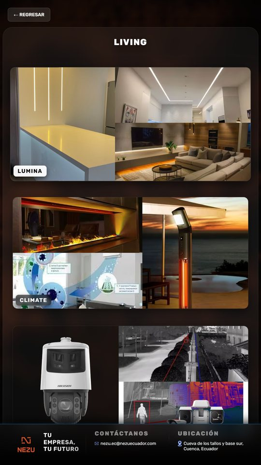
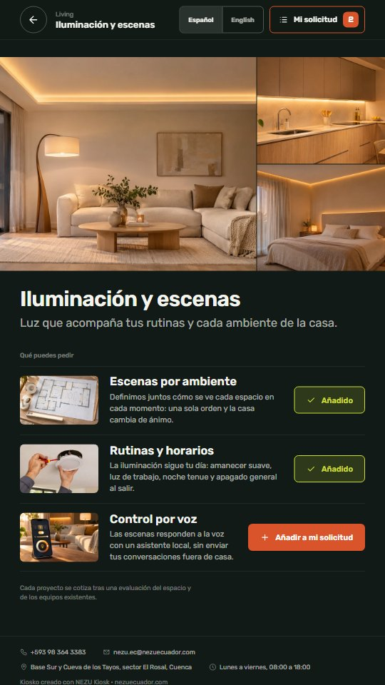
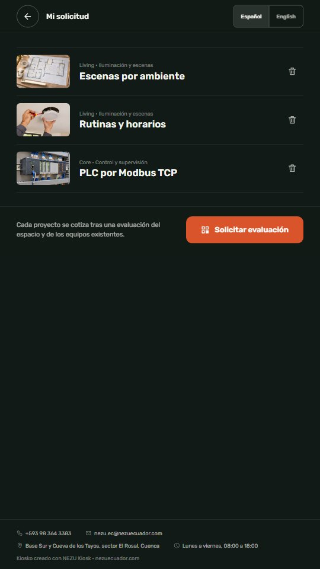
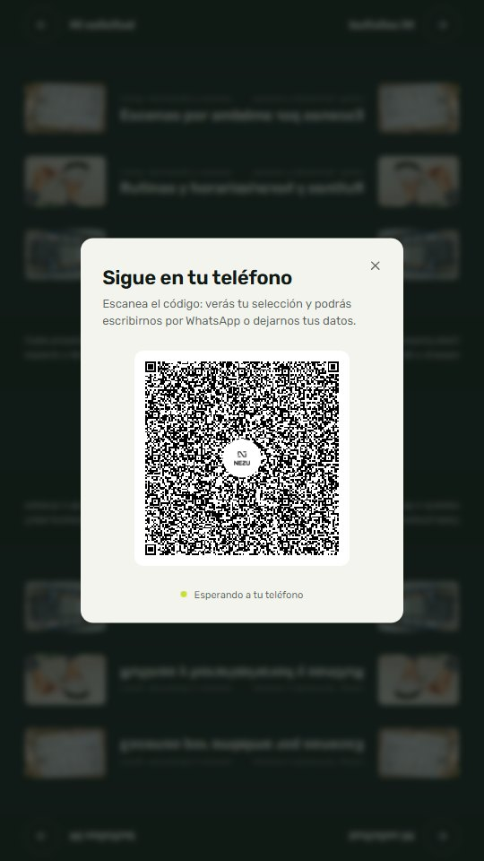
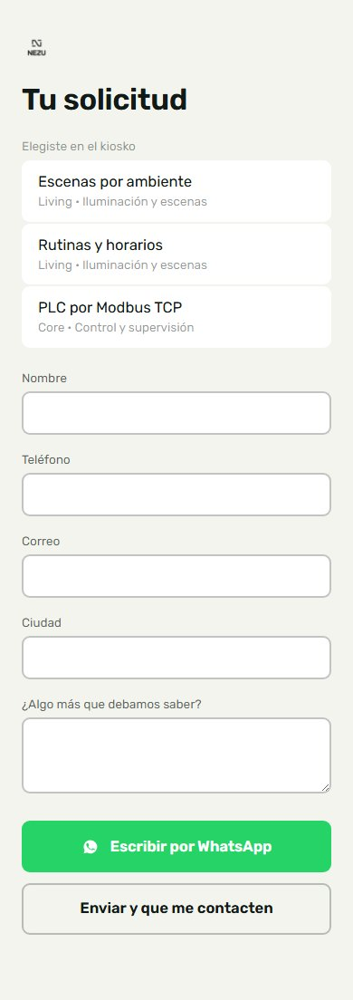
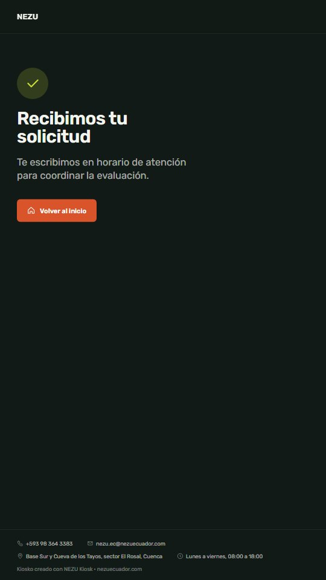

<div align="center">
  
</div>

# NEZU Kiosk

> **In English.** A self-service kiosk for vertical touch totems (1080×1920), built as a template. The shopper browses categories → lines → services, builds a selection and hands it over to their phone through a QR code. Two modes: `quote` (no prices; the phone offers WhatsApp or a contact form) and `payment` (prices, cart, bank QR or card terminal, thermal receipt). Layered architecture (domain · infrastructure · state · UI · features), one config file for the brand, one for the catalog, tokens-based design system, Spanish and English UI with an on-screen switch, kiosk hardening (fullscreen, offline cache, error boundary), usage analytics, server-side payment confirmation, an admin page (cashier + stats), one-command Docker deployment, an operations guide and 91 tests (45 Vitest + 38 node:test + 8 Playwright end-to-end). Every request is stored as JSON Lines and delivered by e-mail or webhook, with an HTTP fallback when the socket is down. The demo runs NEZU's real catalog from nezuecuador.com. React, Vite, TypeScript, Zustand, Socket.IO.

Plantilla de **autoservicio para tótems táctiles verticales**. El cliente recorre categorías, líneas y servicios, arma su selección en la pantalla y termina en su propio teléfono: el kiosko muestra un código QR que abre su selección en el móvil, donde deja sus datos, escribe por WhatsApp o paga.

Dos modos, una sola línea de configuración:

| Modo | Para quién | Qué pasa al final |
|---|---|---|
| `quote` | Negocios que cotizan cada proyecto (es el modo de la demo: NEZU no publica precios) | El teléfono muestra la selección y ofrece **WhatsApp con el mensaje escrito** o un formulario; la solicitud **llega al negocio por correo o webhook** y queda guardada; el kiosko confirma «Recibimos tu solicitud». |
| `payment` | Negocios con precios fijos | Carrito con cantidades y total, razón social y RUC en el teléfono, **QR bancario o tarjeta en el datáfono**, la pantalla avanza sola cuando el servidor **confirma el pago** (pasarela, caja o mostrador), comprobante térmico opcional. |

[**Probar la demo**](https://nezusas.github.io/nezu-kiosk/) · ábrela en una ventana alta y estrecha, o en el modo de dispositivo del navegador a 1080×1920, para verla como en el tótem. El catálogo es el real de NEZU: Living, Elevate y Core.

## Capturas

| Portada | Categorías | Líneas de Living | Servicios |
|---|---|---|---|
|  |  |  |  |

| Mi solicitud | Traspaso al teléfono | Teléfono del cliente | Confirmación |
|---|---|---|---|
|  |  |  |  |

## Hazlo tuyo en 10 minutos

1. **Modo, marca y contacto** · [`src/config/kiosk.config.ts`](src/config/kiosk.config.ts): `mode`, `languages`, nombre, titular de portada, logotipos, WhatsApp, correo, dirección, horario, moneda, colores, tiempo de reposo, opciones del tótem (`kiosk`: identificador, pantalla completa, caché sin conexión, métricas) y la línea de crédito. Los seis colores de marca se vuelven variables CSS al arrancar; todo lo demás se deriva de ellos.
2. **Textos e idiomas** · [`src/config/texts.es.ts`](src/config/texts.es.ts) y [`src/config/texts.en.ts`](src/config/texts.en.ts) cambian solos con el modo; con dos idiomas configurados aparece el selector en pantalla y el reposo vuelve al idioma de arranque. Sobrescribe cualquier texto desde `texts` en la configuración.
3. **Catálogo** · [`src/content/catalog.ts`](src/content/catalog.ts): categorías → líneas → servicios. Añade `price` a los servicios para el modo `payment`. Los tipos viven en [`src/domain/catalog/types.ts`](src/domain/catalog/types.ts) y `npm test` comprueba que no haya identificadores repetidos ni imágenes que falten.
4. **Imágenes** · pon las tuyas en `public/images/` y referencia la ruta desde el catálogo. Las de ejemplo (`public/images/demo/`, ver [`SOURCES.md`](public/images/demo/SOURCES.md)) son ilustraciones generadas para la demo: bórralas cuando tengas las propias. Formato recomendado: WebP 16:9 de 1400 px.
5. **Integraciones** · copia [`.env.example`](.env.example) a `.env.production`: la URL pública de la página del teléfono y, si aplica, el servidor en tiempo real y la impresora.
6. **Publica** · lo más simple es Docker: `cp .env.docker.example .env`, rellena la URL pública y el token, y `docker compose up -d --build` levanta servidor y kiosko juntos en el puerto 4000 (ver [OPERACION.md](OPERACION.md)). También puedes hacer `npm run build` y servir `dist/` en Vercel con el `vercel.json` incluido, desde el propio servidor con `STATIC_DIR`, o en GitHub Pages con `npm run build:demo`, que deja la build en `docs/`.

La línea «Kiosko creado con NEZU Kiosk» del pie se configura en `credit`; agradecemos que se quede, pero la decisión es tuya.

## Cómo está hecho

```text
src/
  domain/          reglas puras, sin React ni navegador
    catalog/       tipos, índice de consulta, validación, formato de precios
    selection/     la selección del cliente: añadir, quitar, cantidades, total
    request/       traspaso al teléfono: resumen en la URL, mensaje de WhatsApp, puertos
    analytics/     eventos de uso y el puerto que los envía
  infrastructure/  adaptadores de los puertos: Socket.IO con respaldo HTTP, impresora, render del comprobante, envío de eventos en lotes
  state/           stores de Zustand construidos sobre el dominio (selección persistida, sesión de traspaso)
  config/          kiosk.config.ts (marca y modo), texts.es.ts (textos por modo), env.ts (variables con defecto)
  content/         el catálogo
  ui/              sistema de diseño: tokens.css, base.css, primitivas (Button, Modal, Stepper), iconos, Screen y Footer
  features/        pantallas por caso de uso: home, catalog, selection, handoff, phone, kiosk (idioma, errores, sin conexión)
  app/             composición: KioskProvider (inyecta config, catálogo y adaptadores), router, tema, reposo
scripts/           build-demo.mjs: la demo para GitHub Pages
docs/              build de la demo (generada, no se edita)
e2e/               pruebas de extremo a extremo con Playwright
Dockerfile, docker-compose.yml, .env.docker.example   despliegue en un comando
OPERACION.md       guía de operación del tótem
server/
  src/             config, sesiones, protocolo Socket.IO, solicitudes (JSONL + correo o webhook), eventos y estadísticas, pagos pendientes y confirmación, Express y arranque
  admin/           página de administración: caja y panel (HTML, CSS y JS sin build)
  test/            pruebas con node:test: registro, protocolo de extremo a extremo, solicitudes, entregas, eventos, pagos y rutas HTTP
```

- **El dominio no sabe de React.** `addService`, `totalOf`, `whatsAppMessage` o `validateCatalog` son funciones puras con pruebas propias.
- **Los adaptadores se inyectan.** Las pantallas piden `useKiosk()` y reciben catálogo, textos, `formatPrice`, el canal con el teléfono y la impresora; las pruebas montan las mismas pantallas con un canal falso.
- **El modo manda.** `quote` o `payment` decide textos, si el botón alterna o suma unidades, qué pide el formulario del teléfono y a qué pantalla vuelve el kiosko.
- **Diseño por tokens.** Rubik para todo, la fuente de marca Disket Mono solo para cifras, naranja NEZU como primario y lima únicamente para «elegido». Objetivos táctiles de 76 px, tipografía que escala con el ancho (20 px en 1080) y una sola animación por pantalla.
- **Pensado para un tótem desatendido.** Pantalla completa al primer toque, service worker que guarda aplicación, fuentes e imágenes para seguir mostrando el catálogo sin red, aviso discreto de desconexión, límite de errores con salida a la portada, sin selección de texto ni menús contextuales, y reposo que limpia selección, sesión e idioma.
- **Métricas sin datos personales.** Pantallas vistas, servicios añadidos, QR abiertos, cambios de idioma y errores viajan en lotes a `POST /api/events`; `GET /api/stats` (con token) resume por día y lista los servicios más pedidos.
- **Administración en `/admin`.** Página del servidor, protegida con el token, con la **caja** (clientes a la espera de cobro, confirmación con la referencia del datáfono o del banco) y el **panel** de la última semana: solicitudes, pagos, eventos y servicios más pedidos.

## Instalarlo en un local

La [guía de operación](OPERACION.md) explica qué hace falta (tótem, un equipo con Docker, una URL pública y un correo o webhook), cómo arrancar el navegador en modo kiosko en Windows, Linux o Android, qué revisar cada día, qué hacer si algo falla y cómo actualizar. En resumen:

```bash
cp .env.docker.example .env   # PUBLIC_URL, ADMIN_TOKEN, correo o webhook
docker compose up -d --build  # kiosko en :4000, teléfono en /phone, administración en /admin
```

## Flujo completo

1. Portada → **categorías** (bandas a sangre) → **líneas** de una categoría → **servicios** de una línea, con «Añadir a mi solicitud».
2. **Mi solicitud** muestra lo elegido (y el total en modo pago). «Solicitar evaluación» abre el **QR**.
3. El QR lleva al teléfono a `/phone?session=…&s=…`: la selección viaja dentro del enlace, así la página funciona aunque el servidor en tiempo real no esté.
4. En el teléfono, el cliente escribe por **WhatsApp** (mensaje precargado con lo elegido) o envía sus datos. El servidor (`server/`) **guarda cada solicitud en disco y la entrega por correo o webhook**, y además avisa al kiosko de esa sesión. Si el socket no conecta, el teléfono la envía por HTTP a `POST /api/leads`: la solicitud no depende de que el kiosko esté encendido.
5. El kiosko salta a **Recibimos tu solicitud**. En modo pago pasa a **pago por QR o tarjeta** y espera: cuando la persona de caja confirma el cobro en `/admin` (o una pasarela llama a `POST /api/payments/confirm`), el servidor avisa al kiosko y la pantalla avanza sola (el botón «Ya pagué» es opcional). Tras dos minutos sin tocar la pantalla, vuelve limpio a la portada.

## Rutas

| Ruta | Pantalla |
|---|---|
| `/` | Portada |
| `/categories` | Categorías |
| `/categories/:categoryId` | Líneas de una categoría |
| `/categories/:categoryId/:lineId` | Servicios de una línea |
| `/selection` | Mi solicitud o mi pedido, con el código QR |
| `/phone` | Página del teléfono del cliente (sin armazón del tótem ni reposo) |
| `/payment` · `/card` | Modo pago: QR bancario o instrucciones del datáfono |
| `/thanks` | Confirmación y vuelta a la portada |

Las rutas de la versión anterior (`/cart`, `/form`, `/payment-options`, `/datafast-instructions`, `/thankyou`) redirigen a las nuevas conservando la consulta, así los QR ya impresos siguen funcionando.

## Ejecutar en desarrollo

```bash
npm install
npm run dev
```

Servidor en tiempo real, en otra terminal (une el teléfono con el kiosko; Vite lo proxea en desarrollo; detalles en [`server/README.md`](server/README.md)):

```bash
cd server
npm install
npm run dev
```

Sin el servidor, todo el recorrido del tótem funciona igual y el cliente puede escribir por WhatsApp; lo que falta es el registro de solicitudes y el salto automático a la pantalla final. Para recibir las solicitudes por correo o webhook, configura `SMTP_URL`/`LEADS_EMAIL_TO` o `LEADS_WEBHOOK_URL` en el servidor (ver su README). En modo pago, la impresión espera un servicio en `VITE_PRINTER_URL` que reciba `POST { image }`; si no está, la pantalla lo indica y el pedido continúa.

## Calidad

```bash
npm run lint    # ESLint, sin errores
npm test        # Vitest: dominio, configuración, catálogo publicado y pantallas
npm run build   # tsc -b && vite build
npm test --prefix server   # node:test: sesiones, protocolo, solicitudes, entregas, eventos, pagos y rutas HTTP
npm run e2e:install        # una vez: el Chromium de Playwright
npm run e2e                # Playwright: construye, arranca el servidor sirviendo el kiosko y recorre tótem, teléfono y administración
```

Las pruebas de extremo a extremo (`e2e/`) usan el despliegue real: el servidor de `server/` sirve la build y atiende el socket, las solicitudes y la administración en un solo origen, igual que en Docker. Recorren el kiosko completo con dos páginas a la vez (tótem y teléfono), comprueban que la solicitud llega al servidor sin tótem y que la caja confirma cobros.

La demo pública se construye con `npm run build:demo` en `docs/` y GitHub Pages la sirve desde `main`; el repositorio tiene una sola rama.

## Tecnología

React 18 · Vite 6 · TypeScript · Zustand · react-router-dom 7 · Socket.IO · qrcode.react · html2canvas · Vitest · Testing Library · Express

## ¿Lo necesitas en tu negocio?

Este kiosko es gratuito: lo publicamos porque lo usamos en nuestros propios proyectos. Si quieres un punto de venta o de captación con traspaso al teléfono, pago por QR e impresión térmica, instalado y adaptado a tu caso, [cuéntanos qué necesitas](https://nezuecuador.com/es/contacto) y te respondemos con una propuesta concreta. Aquí está [lo que hacemos](https://nezuecuador.com/es/servicios).

## Licencia

Licencia NEZU de uso para clientes e integradores: puedes leer, instalar y operar el código y proponer mejoras; no puedes redistribuirlo, venderlo ni usarlo para construir un producto o servicio competidor. Texto completo en [LICENSE.md](LICENSE.md). Las imágenes de ejemplo son ilustraciones generadas por NEZU para la demo y se publican bajo la misma licencia ([`public/images/demo/SOURCES.md`](public/images/demo/SOURCES.md)).

---

<div align="center">
  <sub>Parte del ecosistema <a href="https://github.com/NezuSas">NEZU</a> · <a href="https://nezuecuador.com">nezuecuador.com</a> · © NEZU S.A.S. Publicado para clientes e integradores de NEZU.</sub>
</div>
