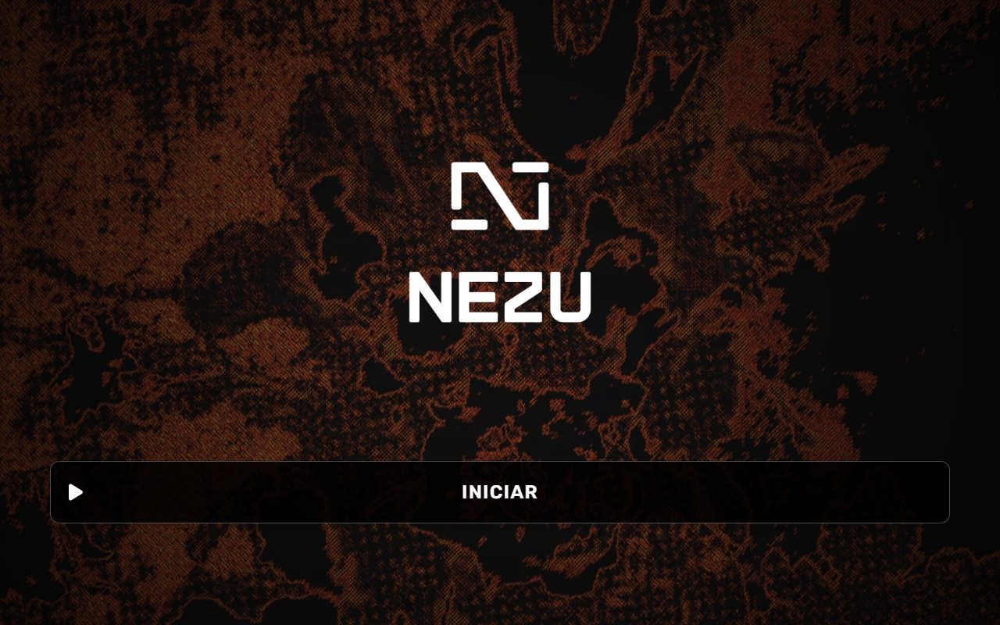
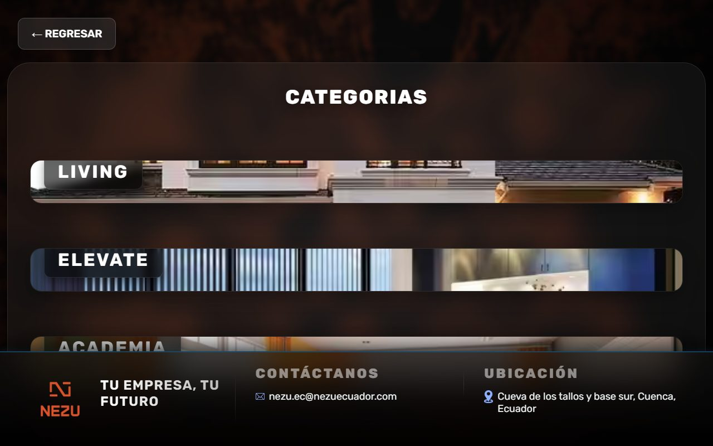
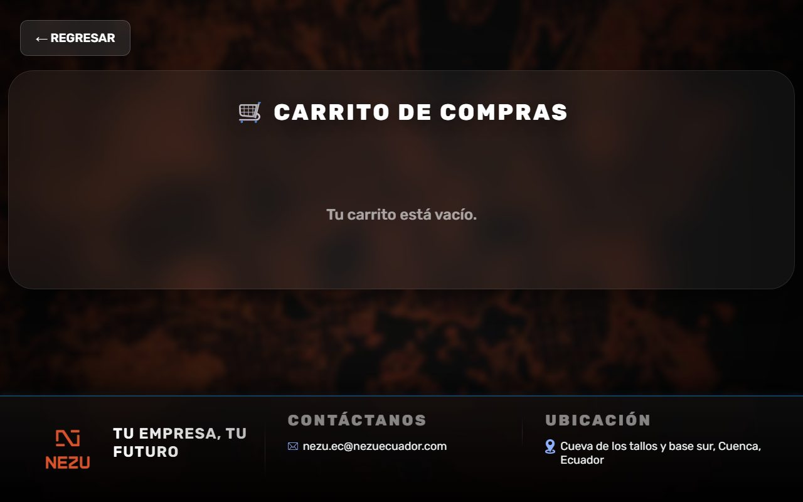

<div align="center">
  
</div>

# NEZU Kiosk

> **In English.** A self-service point-of-sale kiosk for touch screens: catalog, cart, customer form and QR payment, with real-time events over Socket.IO and optional thermal printing. React, Vite and TypeScript, with a live demo.

Aplicación de **autoservicio para puntos de venta**: el cliente recorre categorías y productos en una pantalla táctil, arma su carrito, deja sus datos y paga con un código QR. Pensada para comercios que quieren atender sin fila y sin personal dedicado a tomar pedidos.

Construida con React, Vite y TypeScript, con un pequeño servidor Express y Socket.IO para los eventos en tiempo real entre el kiosko y el punto de cobro.

## Qué hace

- **Catálogo navegable** por categorías y subcategorías hasta el detalle del producto.
- **Carrito** con estado global (Zustand) que se actualiza al instante.
- **Datos del cliente** en un formulario previo al pago.
- **Pago por QR** generado en pantalla, con instrucciones para Datafast, y pantalla de agradecimiento.
- **Tiempo real** con Socket.IO entre el kiosko y el servidor.
- **Diseño adaptable** a distintos tamaños de pantalla.

## Rutas

| Ruta | Pantalla |
|---|---|
| `/` | Inicio |
| `/categories` | Categorías |
| `/categories/:category` | Subcategorías |
| `/categories/:category/:subCategory` | Detalle del producto |
| `/cart` | Carrito |
| `/form` | Datos del cliente |
| `/payment-options` | Opciones de pago |
| `/datafast-instructions` | Instrucciones de pago con Datafast |
| `/thankyou` | Confirmación |

## Ejecutar en desarrollo

```bash
npm install
npm run dev
```

Variables de entorno en `.env.development` o `.env.production`:

```env
VITE_API_URL=        # API de pedidos y pagos
VITE_ENV=            # development | production
VITE_QR_BASE_URL=    # base de las URL codificadas en los QR
```

Servidor de tiempo real, en otra terminal:

```bash
cd server
npm install
npm run dev
```

### Qué funciona sin nada más

El catálogo, el carrito, el formulario y la pantalla de pago con QR corren solos: con `npm run dev` ya se puede recorrer todo el flujo. Dos piezas dependen de servicios externos que **no** están en este repositorio:

| Pieza | Qué espera | Si no está |
|---|---|---|
| Impresión del ticket | Un servicio de impresión térmica escuchando en `http://127.0.0.1:5000/print` (POST con el pedido). NEZU usa un agente propio; cualquier servicio que acepte ese JSON sirve. | La app avisa que no hay impresora y el pedido continúa. |
| Pedidos y pagos | La API indicada en `VITE_API_URL`, que recibe el pedido y confirma el pago del QR. | El QR se genera igual (con `VITE_QR_BASE_URL`), pero no hay confirmación. |

Para probarlo en el navegador sin instalar nada: [**demo en línea**](https://nezusas.github.io/nezu-kiosk/).

## Calidad y construcción

```bash
npm run lint       # ESLint
npm test           # Vitest
npm run build      # tsc -b && vite build
npm run preview    # sirve la build localmente
```

La aplicación se despliega en Vercel con la configuración de `vercel.json`. La demo pública se construye con `npm run build -- --base=/nezu-kiosk/` y se publica en GitHub Pages.

## Capturas

| Inicio | Categorías | Carrito |
|---|---|---|
|  |  |  |

## Estructura

```text
src/
  pages/          pantallas: inicio, categorías, carrito, formulario, pago
  components/     componentes reutilizables
  routes/         rutas con react-router-dom
  store/          estado global con Zustand
  services/       acceso a la API
  integrations/   integraciones externas
  hooks/ utils/   apoyo
  config/ types/  configuración y tipos
  styles/         estilos globales y por módulo
server/           Express + Socket.IO
```

## Tecnología

React · Vite · TypeScript · Zustand · react-router-dom · Socket.IO · qrcode.react · Vitest · Express

## ¿Lo necesitas en tu negocio?

Este kiosko es gratuito: lo publicamos porque lo usamos en nuestros propios proyectos. Si quieres un punto de venta con carrito, pago por QR e impresión térmica en tu negocio, instalado y adaptado a tu caso, [cuéntanos qué necesitas](https://nezuecuador.com/es/contacto) y te respondemos con una propuesta concreta. Aquí está [lo que hacemos](https://nezuecuador.com/es/servicios).

## Licencia

Licencia NEZU de uso para clientes e integradores: puedes leer, instalar y operar el código y proponer mejoras; no puedes redistribuirlo, venderlo ni usarlo para construir un producto o servicio competidor. Texto completo en [LICENSE.md](LICENSE.md).

---

<div align="center">
  <sub>Parte del ecosistema <a href="https://github.com/NezuSas">NEZU</a> · <a href="https://nezuecuador.com">nezuecuador.com</a> · © NEZU S.A.S. Publicado para clientes e integradores de NEZU.</sub>
</div>
