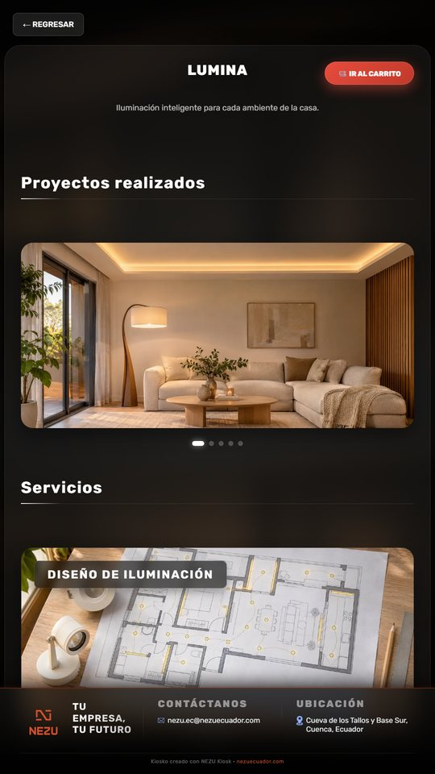
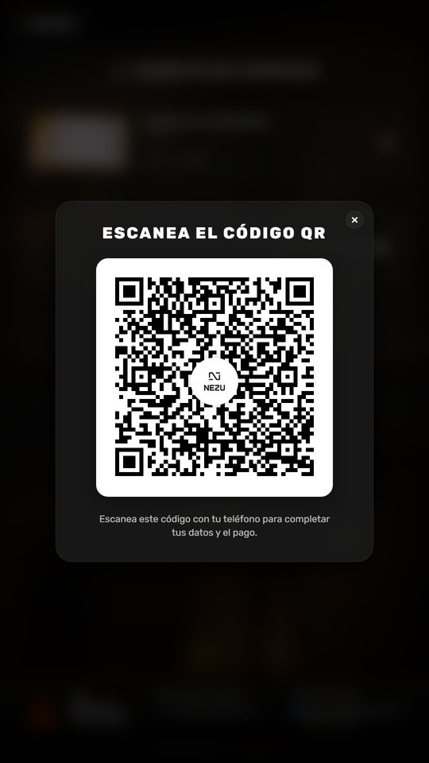

<div align="center">
  
</div>

# NEZU Kiosk

> **In English.** A ready-to-brand self-service kiosk for vertical touch totems (1080×1920): catalog, cart and a QR code that hands the customer form and payment over to the shopper's phone. One config file for the brand, one file for the catalog, AI-generated sample imagery free of third-party rights, a live demo, and real-time events over Socket.IO with optional thermal printing. React, Vite and TypeScript.

Plantilla de **autoservicio para puntos de venta** en un tótem táctil vertical. El cliente recorre categorías y servicios, arma su pedido en la pantalla y termina en su propio teléfono: al continuar, el kiosko muestra un código QR que abre el formulario de datos y el pago.

Pensada para que la hagas tuya en minutos: la marca vive en un archivo, el catálogo en otro, y las imágenes de ejemplo son ilustraciones generadas para la demo, sin derechos de terceros, para que puedas publicarla mientras preparas tus propias fotos.

[**Probar la demo**](https://nezusas.github.io/nezu-kiosk/) · abre la demo en una ventana alta y estrecha, o en el modo de dispositivo del navegador a 1080×1920, para verla como en el tótem.

## Capturas

| Inicio | Categorías | Living |
|---|---|---|
|  |  |  |

| Detalle | Carrito | Pago por QR |
|---|---|---|
|  |  |  |

## Hazlo tuyo en 10 minutos

1. **Marca y textos** · [`src/kiosk.config.ts`](src/kiosk.config.ts): nombre, eslogan, logos, contacto, moneda, colores, textos de pantalla y el tiempo de reposo. Los colores pasan a variables CSS al arrancar; no hay que tocar hojas de estilo.
2. **Catálogo** · [`src/content/catalog.ts`](src/content/catalog.ts): categorías → líneas de servicio → servicios con precio, descripción e imagen. Los tipos están en [`src/content/types.ts`](src/content/types.ts) y el editor te avisa si falta algo.
3. **Imágenes** · pon las tuyas en `public/images/` y referencia la ruta desde el catálogo. Las de ejemplo viven en `public/images/demo/` (ilustraciones fotorrealistas generadas con IA, ver [`SOURCES.md`](public/images/demo/SOURCES.md)); bórralas cuando tengas las propias. Formato recomendado: WebP horizontal 16:9 de 1400 px de ancho.
4. **Integraciones** · copia [`.env.example`](.env.example) a `.env.development` y `.env.production`: la URL del formulario que abre el QR y la API que recibe el pedido.
5. **Publica** · `npm run build` y sirve `dist/` donde prefieras; para GitHub Pages, `npm run build -- --base=/<repo>/`.

La línea «Kiosko creado con NEZU Kiosk» del pie se configura en `credit`; agradecemos que se quede, pero la decisión es tuya.

## Qué hace

- **Catálogo navegable** por categorías y líneas de servicio hasta el detalle, con galería de proyectos y carrusel de servicios.
- **Carrito** con estado global (Zustand) que se actualiza al instante y sobrevive a un reinicio del navegador.
- **Pago por QR**: el kiosko genera un código con una sesión única; el teléfono abre el formulario, elige el método y el kiosko avanza solo gracias a Socket.IO.
- **Reposo**: tras el tiempo configurado sin tocar la pantalla vuelve a la portada (o reproduce un vídeo de atracción si indicas uno), para que el siguiente cliente no encuentre un carrito ajeno.
- **Impresión térmica** opcional del comprobante a través de un servicio local.
- **Diseño vertical** medido para 1080×1920, con tipografía propia y animaciones suaves.

## Rutas

| Ruta | Pantalla |
|---|---|
| `/` | Portada |
| `/categories` | Categorías |
| `/categories/:category` | Líneas de servicio de una categoría |
| `/categories/:category/:subCategory` | Detalle: proyectos y servicios |
| `/cart` | Carrito y código QR |
| `/form` | Formulario de datos (se abre en el teléfono) |
| `/payment-options` | Opciones de pago |
| `/datafast-instructions` | Instrucciones de pago con tarjeta |
| `/thankyou` | Confirmación |

## Ejecutar en desarrollo

```bash
npm install
cp .env.example .env.development
npm run dev
```

Servidor de tiempo real, en otra terminal (recibe los datos que envía el teléfono y los entrega al kiosko):

```bash
cd server
npm install
npm run dev
```

### Qué funciona sin nada más

El catálogo, el carrito y el código QR corren solos: con `npm run dev` ya se puede recorrer todo el flujo del tótem. Dos piezas dependen de servicios externos que **no** están en este repositorio:

| Pieza | Qué espera | Si no está |
|---|---|---|
| Impresión del ticket | Un servicio de impresión térmica escuchando en `http://127.0.0.1:5000/print` (POST con el pedido). NEZU usa un agente propio; cualquier servicio que acepte ese JSON sirve. | La app avisa que no hay impresora y el pedido continúa. |
| Datos del cliente y pago | El QR lleva al teléfono del cliente a `VITE_QR_BASE_URL` (el formulario `/form` y el pago), y la API de `VITE_API_URL` recibe el pedido y confirma el pago. | El QR se genera igual, pero al escanearlo no hay quien responda. |

## Calidad y construcción

```bash
npm run lint       # ESLint, sin errores
npm test           # Vitest
npm run build      # tsc -b && vite build
npm run preview    # sirve la build localmente
```

La aplicación se despliega en Vercel con la configuración de `vercel.json`. La demo pública se construye con `npm run build -- --base=/nezu-kiosk/` y se publica en GitHub Pages.

## Estructura

```text
src/
  kiosk.config.ts   marca, textos, colores, moneda y reposo  ← empieza aquí
  content/          catálogo de ejemplo y sus tipos           ← y aquí
  pages/            pantallas: portada, categorías, detalle, carrito, formulario, pago
  components/       componentes reutilizables (tarjetas, carruseles, QR, pie)
  routes/           rutas con react-router-dom
  store/            estado global con Zustand
  services/         conexión Socket.IO
  integrations/     impresión térmica
  hooks/ utils/     apoyo (precarga de imágenes, rutas de assets)
  styles/           estilos globales y variables del tema
public/images/
  brand/            logos e iconos de la marca
  demo/             fotos de ejemplo con licencia libre (SOURCES.md)
server/             Express + Socket.IO
```

## Tecnología

React · Vite · TypeScript · Zustand · react-router-dom · Socket.IO · qrcode.react · Vitest · Express

## ¿Lo necesitas en tu negocio?

Este kiosko es gratuito: lo publicamos porque lo usamos en nuestros propios proyectos. Si quieres un punto de venta con carrito, pago por QR e impresión térmica en tu negocio, instalado y adaptado a tu caso, [cuéntanos qué necesitas](https://nezuecuador.com/es/contacto) y te respondemos con una propuesta concreta. Aquí está [lo que hacemos](https://nezuecuador.com/es/servicios).

## Licencia

Licencia NEZU de uso para clientes e integradores: puedes leer, instalar y operar el código y proponer mejoras; no puedes redistribuirlo, venderlo ni usarlo para construir un producto o servicio competidor. Texto completo en [LICENSE.md](LICENSE.md). Las imágenes de ejemplo son ilustraciones generadas por NEZU para la demo y se publican bajo la misma licencia ([`public/images/demo/SOURCES.md`](public/images/demo/SOURCES.md)).

---

<div align="center">
  <sub>Parte del ecosistema <a href="https://github.com/NezuSas">NEZU</a> · <a href="https://nezuecuador.com">nezuecuador.com</a> · © NEZU S.A.S. Publicado para clientes e integradores de NEZU.</sub>
</div>
